<div align="center">


### Your first step towards more.

An internship portal for university students in Pakistan

**[Live website](https://internbloom.vercel.app/)** · **[GitHub repository](https://github.com/alishba-1805/internbloom)**

CS4032 Web Programming · BS Cyber Security · Fall 2026 · Assignment 3: Next.js Frontend

<br>

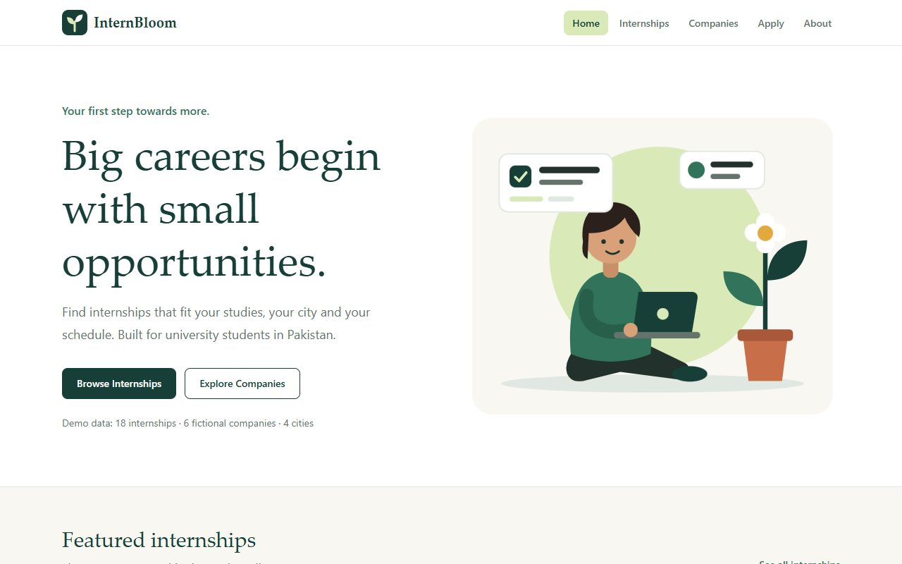

</div>

## Contents

[Project details](#project-details) · [About](#about-the-app) · [Features](#features) · [Screenshots](#screenshots) · [Architecture](#architecture) · [Flowcharts](#flowcharts) · [How to run](#how-to-run) · [Routes](#routes) · [Contribution](#contribution-table) · [Limitations](#limitations)

## Project details

| Item | Details |
|---|---|
| Group number | 41 |
| Topic number | 48 |
| Topic title | Internship Portal for Students |
| Category | Careers |

| Name | Roll number | Role |
|---|---|---|
| Alishba Inam | 24i-2036 | Group Leader |
| Amna Zainab | 24i-2085 | Group Member |
| Hafsa Naeem | 24i-2001 | Group Member |

## About the app

InternBloom is an internship portal for university students in Pakistan. Students can search, filter and sort internships, read about each role and company, and try a demo application that appears in a tracker. It is a frontend-only project, so all companies and listings are made up and no application is actually sent or saved.

## Features

| Area | What you can do |
|---|---|
| Discover | Search 18 internships by title, company name or skill |
| Narrow down | Combine field, city and work arrangement filters, then reset them in one click |
| Compare | Sort by most recent or by stipend |
| Read more | Open a separate page for every internship and for each of the six companies |
| Apply | Fill in a form that explains exactly what needs correcting |
| Track | See submitted applications, with a block on applying twice using the same email |
| Any screen | Use it on mobile, tablet and desktop, with a menu for small screens |

## Screenshots

All screenshots were taken from the live website. The names in the form are sample data.

### Finding an internship

| Search and filters | Internship details |
|---|---|
| 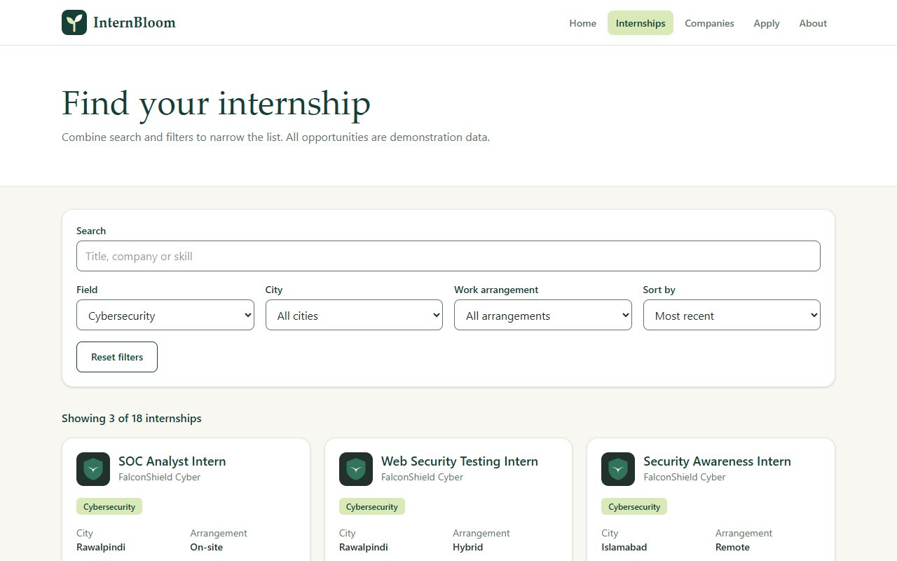 | 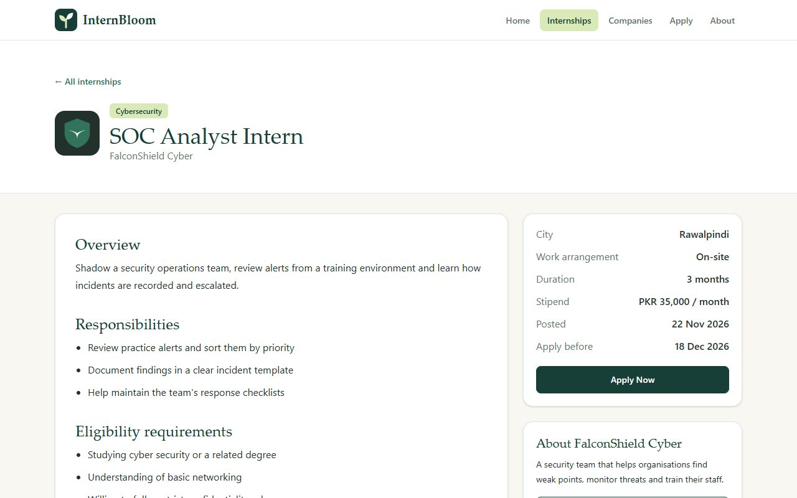 |

### Exploring companies

| Company directory | Company profile |
|---|---|
| 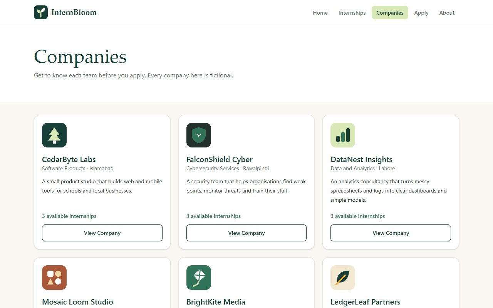 | 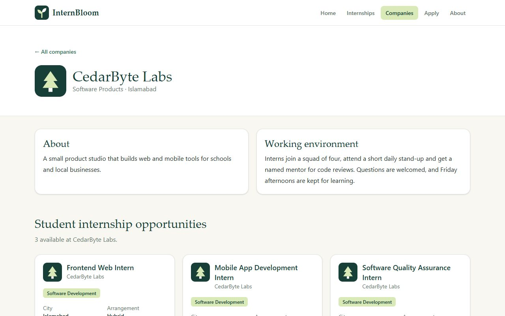 |

### Applying and tracking

| Form validation | Confirmation and tracker |
|---|---|
| 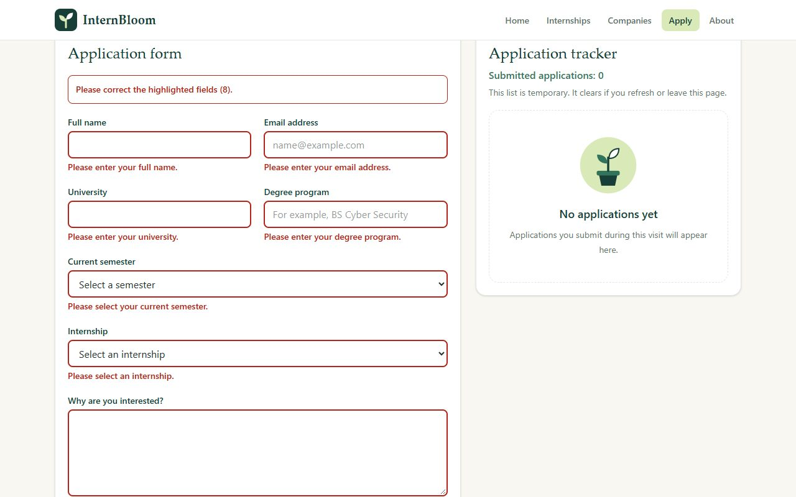 | 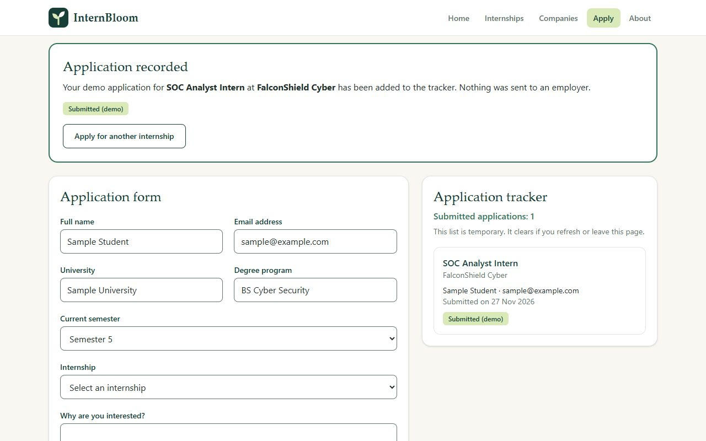 |

### About and 404

| About page | Custom 404 page |
|---|---|
| 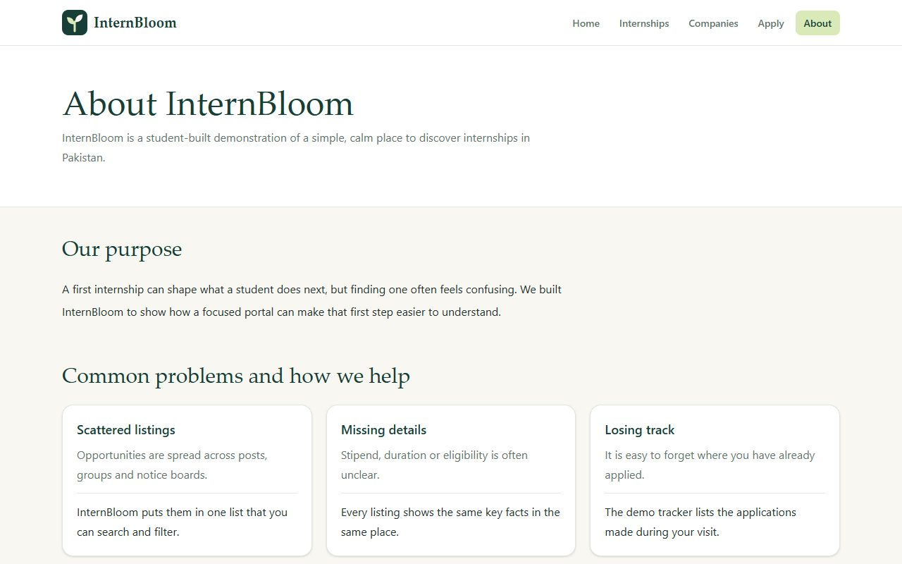 | 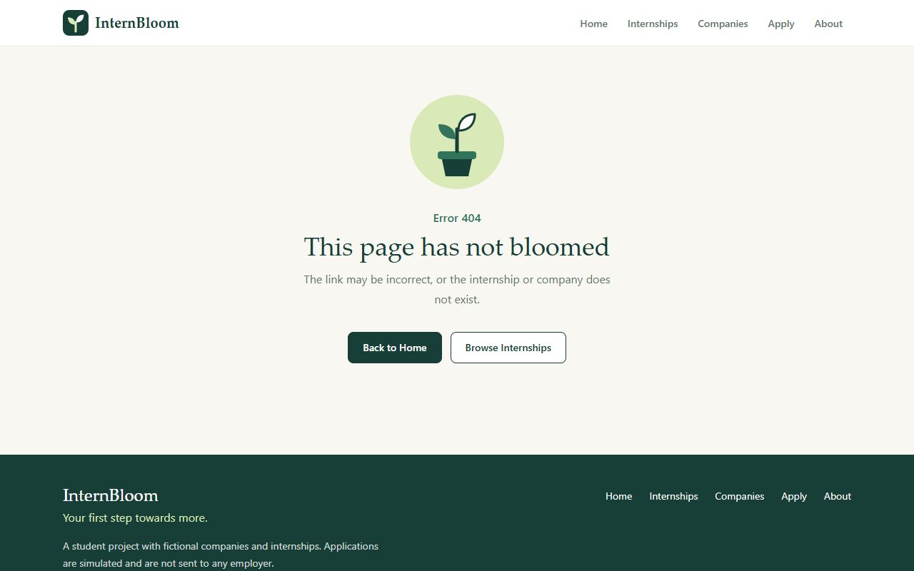 |

### Mobile view (375 px)

| Home | Menu | Internships |
|:---:|:---:|:---:|
| 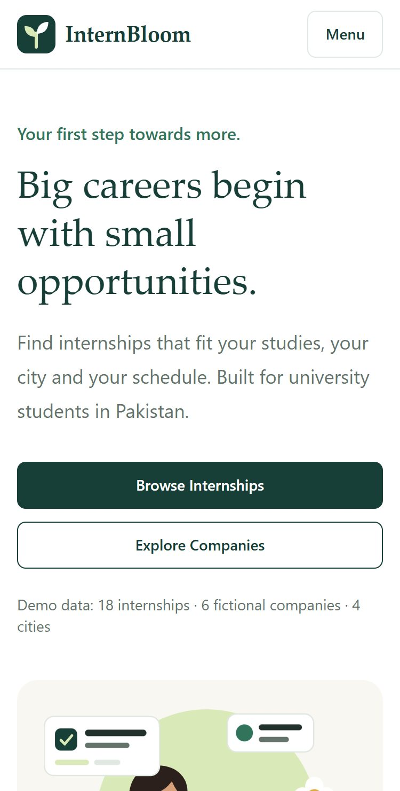 | 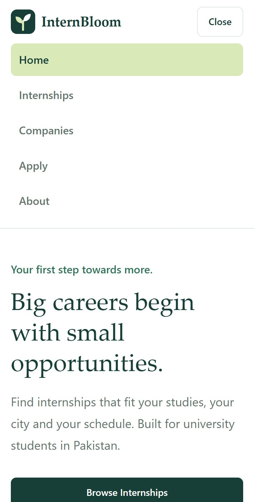 | 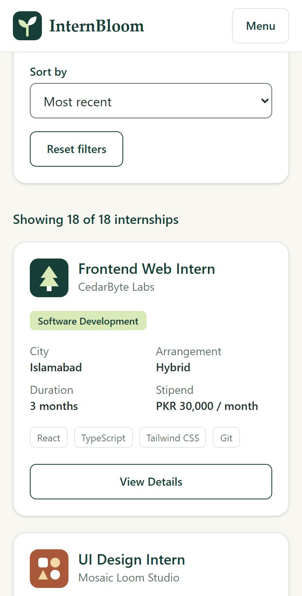 |

## Technology

| Tool | Used for |
|---|---|
| Next.js 16 (App Router) | Routing, layouts, metadata, images and links |
| React 19 | Components, props and state |
| TypeScript | Types for every record and component |
| Tailwind CSS 4 | Styling and responsive layouts |
| ESLint and npm | Code checks and packages |
| Vercel | Hosting the live website |

## Architecture

### How the app is organised

Pages read the mock data and pass it to components as props. There is no server database or API.

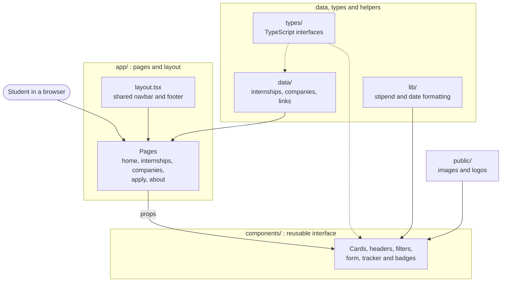

### Server and Client Components

Pages stay on the server. Only the three components that need state and events are marked `"use client"`. The components they import also run in the browser.

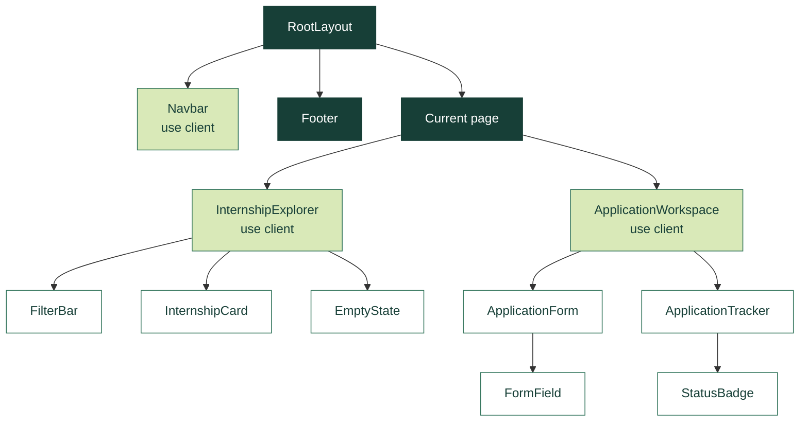

| Colour | Meaning |
|---|---|
| Dark green | Server Component |
| Light green | Client Component marked `"use client"` |
| White | Runs in the browser here because a Client Component imports it |

### Reusable components

| Component | Used by |
|---|---|
| `InternshipCard` | Home, internship listing, internship detail and company profile |
| `PageHeader` | Internships, companies, apply and about |
| `SectionHeading` | Home, about, internship detail and company profile |
| `EmptyState` | Internship results and application tracker |
| `FieldBadge` | Internship cards and internship detail |
| `StatusBadge` | Application confirmation and tracker |

## Flowcharts

### Moving around the site

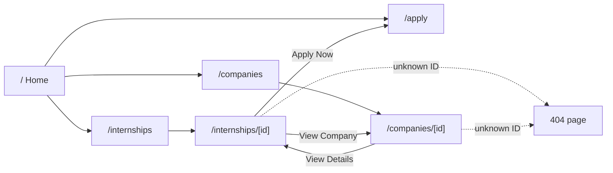

### Search, filter and sort

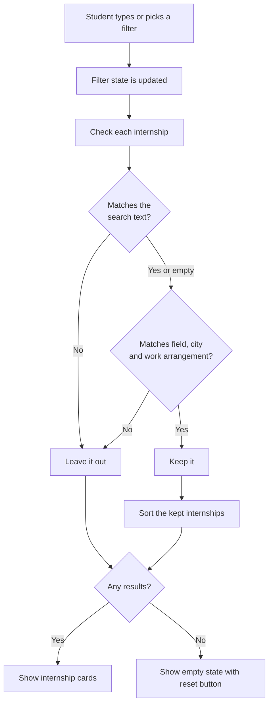

### Submitting an application

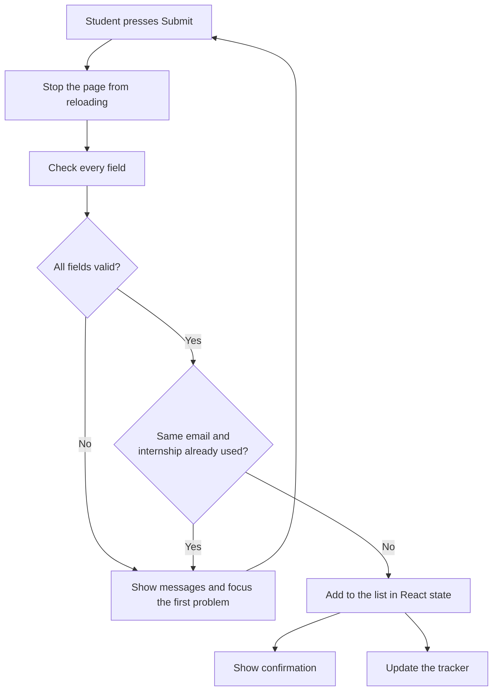

### How state moves on the apply page

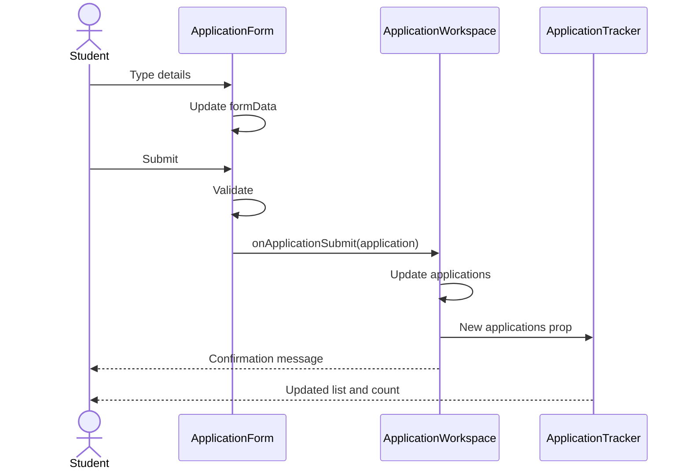

## How to run

You need Node.js 20.9 or newer.

```bash
npm install
npm run dev
```

Then open <http://localhost:3000>.

To check the production build:

```bash
npm run build
npm start
```

## Routes

| Route | What it shows |
|---|---|
| `/` | Introduction, newest internships, popular fields and how it works |
| `/internships` | All internships with search, filters and sorting. `?field=` selects a field |
| `/internships/[id]` | Full details of one internship and similar roles |
| `/companies` | The six companies and how many internships each offers |
| `/companies/[id]` | Company profile, working environment and its internships |
| `/apply` | Application form and tracker. `?internship=` selects a role |
| `/about` | Why we built the app, its features and our team |
| Any unknown address or ID | Custom 404 page |

## Contribution table

| Member | Responsibility | Pages | Components and other files | Share |
|---|---|---|---|---:|
| Alishba Inam (Leader) | Architecture, core internship module, integration and deployment | `/internships`, `/internships/[id]` | InternshipExplorer, FilterBar, InternshipCard, FieldBadge, internship data, shared types, formatting helpers, project setup | 35% |
| Amna Zainab | UI/UX, homepage, layout and company module | `/`, `/about`, `/companies`, `/companies/[id]`, root layout | Navbar, Footer, CompanyCard, SectionHeading, PageHeader, company data, global styles, logos and images | 33% |
| Hafsa Naeem | Application form, validation and state management | `/apply`, 404 page, loading screen | ApplicationWorkspace, ApplicationForm, ApplicationTracker, FormField, StatusBadge, EmptyState | 32% |

## Project structure

```text
internbloom/
├── app/            Pages, layout, 404 and loading files
├── components/     Reusable components with typed props
├── data/           Internship, company and navigation data
├── lib/            Small formatting functions
├── types/          TypeScript interfaces
├── public/         Images and company logos
└── screenshots/    Pictures used in this README
```

## Limitations

- All companies, listings, stipends and dates are sample data.
- Applications are simulated and nothing is sent to an employer.
- The tracker clears when the page is refreshed or when you leave it.

## Images

The logo, icon, illustrations and company logos are SVG files made for this project. The screenshots show our live website. No third-party images or downloaded fonts are used.
